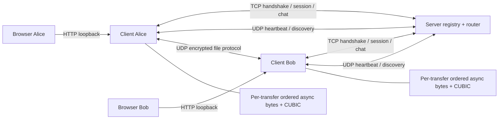
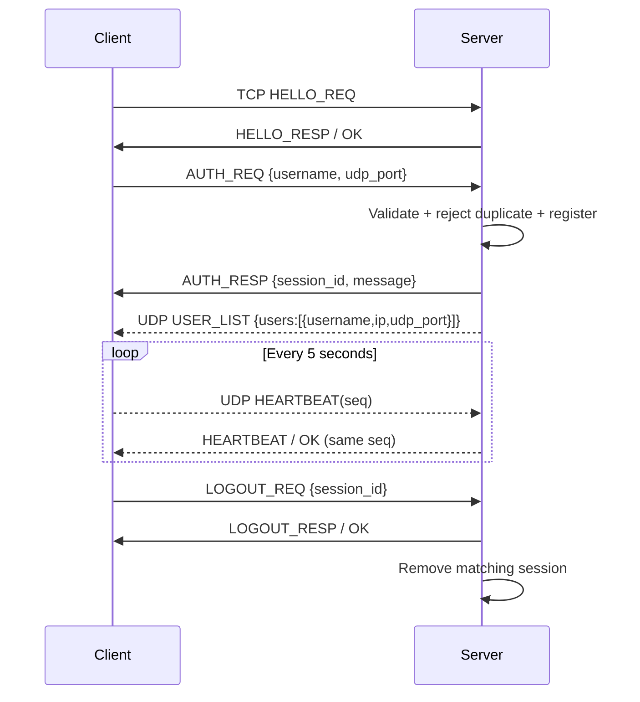
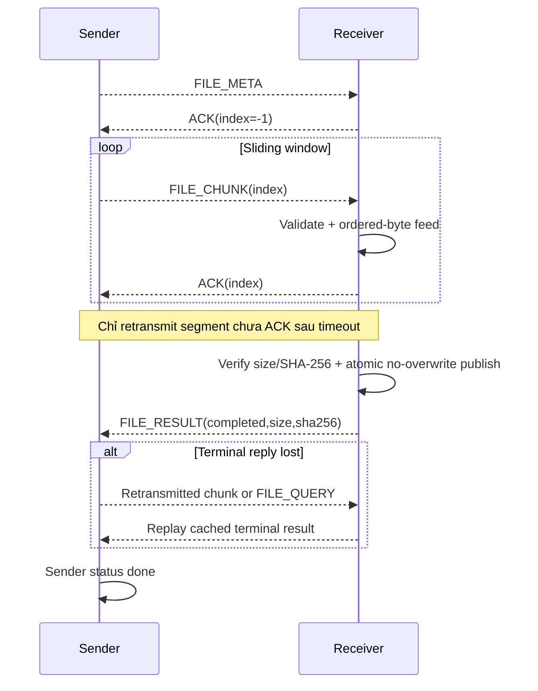

# Giao thức Assignment 1 — hợp đồng của release closure

Tài liệu này mô tả implementation trong nhánh release; `protocol.py`, `client.py`, `server.py`, `file_client.py`, `file_transfer.py`, `stream_transport.py` và `udp_streamer.py` là nguồn đối chiếu. Giao thức file tích hợp và standalone byte-stream demonstrator có cách biểu diễn khác nhau; không trộn hai wire format.

## 1. Kiến trúc và transport



Server bind `0.0.0.0:9000/TCP` và `0.0.0.0:9001/UDP`. Mỗi client tự bind UDP port động và công bố port qua login. HTTP bridge bind `127.0.0.1:<ui-port>` trên máy client. Server định tuyến chat; file đi trực tiếp giữa peer sau discovery.

## 2. Header chung

Header 8 byte, network byte order, struct `!HBBHH`:

| Offset | Trường | Kiểu | Ý nghĩa |
|---|---|---|---|
| 0–1 | magic | uint16 | `0xDCBA` |
| 2 | msg_type | uint8 | Opcode |
| 3 | status | uint8 | `0=NONE`, `1=OK`, `2=ERR` |
| 4–5 | seq_no | uint16 | Correlation/sequence theo loại giao thức; modulo 65536 |
| 6–7 | payload_len | uint16 | Số byte payload, tối đa 65535 |
| 8… | payload | bytes | JSON, Fernet token hoặc bytes tùy opcode/kênh |

UDP datagram phải có độ dài đúng `8 + payload_len`. TCP là byte stream: reader phải ghép đủ header/payload dù bị phân mảnh; không giả định một `recv()` tương đương một packet. Client HELLO+AUTH sử dụng deadline tổng 5 giây sau khi kết nối TCP; server giới hạn HELLO+AUTH trong 10 giây. Deadline dùng monotonic clock nên client gửi nhỏ giọt không kéo dài vô hạn handshake.

| Opcode | Tên | Kênh và công dụng |
|---|---|---|
| `0x01`, `0x02` | HELLO_REQ/RESP | TCP, bắt tay ứng dụng |
| `0x03`, `0x04` | AUTH_REQ/RESP | TCP, đăng ký username và cấp session ID |
| `0x05`, `0x06` | LOGOUT_REQ/RESP | TCP, đóng phiên |
| `0x10` | HEARTBEAT | UDP, request và response cùng seq |
| `0x11` | USER_LIST | UDP server→client, snapshot danh sách người dùng |
| `0x12` | EOF | Chỉ standalone UDP stream, kết thúc có sequence riêng |
| `0x20` | DATA | TCP JSON chat **hoặc** UDP Fernet JSON file **hoặc** standalone stream bytes |
| `0x21` | ACK | Chỉ standalone UDP stream; file tích hợp dùng JSON `kind=ACK` trong DATA |

## 3. Phiên, discovery và liveness



Username được trim, chuẩn hóa NFC, giới hạn 64 ký tự/120 byte UTF-8; chỉ chữ/số, dấu cách, `_`, `-`. `*` là broadcast, không được đăng ký thành username. Port phải là integer 1–65535, không nhận boolean. Login là cơ chế unique-name session: trường password không được server kiểm tra. Duplicate username bị từ chối; session ID bảo vệ việc unregister nhầm phiên.

Server chỉ chấp nhận heartbeat từ cặp IP/UDP port đã đăng ký. Watchdog quét mỗi 3 giây, loại peer im lặng quá 15 giây và đóng TCP; TCP EOF cũng dọn phiên. Snapshot được phát khi registry thay đổi và refresh định kỳ xấp xỉ 10 giây (theo nhịp watchdog). Version được tăng và lấy snapshot trong cùng lock; version 0 được bỏ qua khi wrap.

Client kiểm tra nguồn USER_LIST là IP/port server. So sánh sequence bằng khoảng modulo: snapshot cũ/out-of-order bị bỏ qua; snapshot trùng hợp lệ chỉ cập nhật mốc server phản hồi. UDP control không có MAC riêng nên không chống attacker có khả năng giả nguồn server. Heartbeat response chỉ làm mới liveness khi khớp một seq đang chờ.

`state().connection.status`: `connected` khi có phản hồi server hợp lệ trong 20 giây, `stale` khi quá hạn mà TCP chưa xác nhận đóng, `disconnected` khi phiên đã đóng. Đây là trạng thái dựa trên lần phản hồi gần nhất, không phải bảo đảm server còn sống ngay tại mọi thời điểm. HTTP 200 của `/api/state` chỉ chứng minh bridge local đang trả lời. Đóng phiên xóa user/peer list và ngừng tài nguyên mạng; phục hồi bằng khởi động lại client, không tự reconnect.

## 4. Chat trên TCP

Broadcast request:

```json
{"mode":"broadcast","message":"<Fernet token>","enc":true}
```

Private request thêm `"mode":"unicast","recipient":"bob"`. Server lấy sender từ phiên TCP đã đăng ký, không tin trường sender do client gửi, rồi chuyển JSON gồm `mode`, `sender`, `message`, `enc` và `recipient` khi private. Broadcast không echo trở lại sender; client lưu bản ghi outgoing local.

Mỗi peer có outbox riêng tối đa 64 frame và writer riêng. Queue đầy/send lỗi khiến peer bị đóng, không để một reader chậm giữ luồng định tuyến tới peer khác. Lỗi schema, recipient offline hoặc payload chuyển tiếp vượt 65535 byte trả DATA/ERR với seq gốc để UI liên hệ operation. TCP cung cấp thứ tự byte; không có ACK ứng dụng xác nhận người nhận đã đọc/hiển thị chat. Nhãn submitted không được diễn giải là delivered.

Server chấp nhận schema chat legacy `enc` vắng mặt để tương thích script; client chuẩn luôn mã hóa text. Vì vậy hệ thống không cưỡng chế encrypted-only đối với mọi client tùy biến.

## 5. File tích hợp trên UDP

Mỗi payload DATA là Fernet-encrypted JSON. `file_id` là UUID hex 32 ký tự, `sha256` là 64 ký tự hex; chunk logical index không bị giới hạn bởi seq header 16-bit. Receiver ràng buộc transfer với peer đã discovery; ACK và FILE_RESULT chỉ được nhận từ đúng peer đang gửi tới.

| `kind` | Các trường chính | Hợp đồng |
|---|---|---|
| `FILE_META` | `file_id,to,filename,size,sha256,chunk_size,total_chunks` | Metadata phải khớp size/chunk count; gửi lại metadata giống hệt là idempotent |
| `ACK` | `file_id,to,chunk_index` | `-1` xác nhận metadata; `0..n-1` xác nhận chunk đã chấp nhận |
| `FILE_CHUNK` | `file_id,to,chunk_index,total_chunks,data` | `data` Base64 trong JSON mã hóa; kiểm index, length, total và duplicate conflict |
| `FILE_RESULT` | `file_id,to,status,error,size,sha256` | Receiver kết thúc với `completed`, `failed` hoặc `timeout`; completed cần đúng size/hash ở sender |
| `FILE_QUERY` | `file_id,to` | Sender hỏi lại terminal result khi kết quả trước bị mất |



Chunk mặc định 700 byte; file rỗng có một chunk rỗng. Receiver nhận tối đa 100 MiB và 200000 logical chunks/file, tối đa 8 active transfers. Metadata retry dùng 5 lần gửi, timeout 0,5 giây; dữ liệu có selective retry cho những entry chưa ACK, tối đa 5 retransmissions/chunk sau lần gửi đầu. Hết mọi chunk ACK nhưng chưa nhận result thì sender query lại tối đa 5 lần. Không nhận được result hợp lệ dẫn đến **completion unconfirmed**, không tự suy ra receiver thất bại hoặc thành công.

Receiver ghi từng chunk đúng thứ tự sau khi hash khớp vào `.part`, flush/fsync rồi `os.link` để publish không ghi đè file đã tồn tại; xóa temporary link sau đó. Không có partial final filename được công bố là completed. Filesystem phải hỗ trợ hard links. Terminal cache chỉ giữ metadata/kết quả, tối đa 256 bản ghi và 120 giây; sau horizon này không có bảo đảm truy vấn lịch sử. Receiver inactivity timeout 120 giây được kiểm trong cleanup loop 30 giây; timeout hiển thị có thể xuất hiện sau khoảng 120–150 giây không hoạt động. Đóng client hủy receiving streams và sender workers.

Sender progress là tỷ lệ chunk đã ACK; 100% vẫn có thể đang chờ result. Receiver `completed` nghĩa là đã kiểm tra và publish; sender `done` chỉ sau receiver result hợp lệ. `get_progress()` lấy trực tiếp trạng thái receiver, tránh bản sao stale khi timeout. HTTP dùng staging directory riêng từng request nên hai upload cùng basename không dùng chung nội dung nguồn.

File giữ tối đa 100 MiB nội dung theo chunk cộng object/encryption overhead mỗi transfer; 8 lượt gửi và 8 lượt nhận có thể cùng tồn tại. Không tuyên bố disk streaming có RAM hằng số. HTTP file API hỗ trợ một recipient; Python API fanout có thể chấp nhận một phần trước khi hết active capacity, không phải atomic broadcast file.

## 6. Async bytes và congestion control

`OrderedByteStream` nhận logical index và bytes, giữ segment out-of-order, trả các byte liên tục bằng `await stream.read()`/async iterator. Nó không biết filename, JSON, key hoặc socket. `FileReceiver.get_stream(file_id)` cho subscriber lấy stream khi transfer còn active. Byte đọc sớm là provisional; EOF chỉ được phát sau integrity/commit; `fail()` đánh thức reader với exception và giải phóng buffer. Hủy reader không tiêu thụ dữ liệu hoặc để waiter mắc kẹt.

Mỗi transfer có state/window riêng. Một khoảng trống trong stream A không bắt stream B chờ; trong chính A, các byte sau khoảng trống vẫn phải đợi để bảo toàn thứ tự. Final hash/disk commit vẫn đồng bộ trên receiver; không tuyên bố latency cứng hoặc loại bỏ mọi nguồn blocking của OS/filesystem.

`CubicWindow` dùng slow start, tăng cửa sổ theo ACK, hàm cubic theo thời gian và RTT, hệ số giảm 0,7, reset window khi timeout và cửa sổ tối đa 64 segment cho cấu hình hiện tại. Duplicate ACK không làm tăng window; RTT của segment đã retransmit không dùng để lấy mẫu. Đây là controller trong ứng dụng được kiểm tra hành vi, không phải một TCP/QUIC stack tuân thủ đầy đủ, không có BBR, ECN, HyStart++ hoặc chứng nhận fairness trên Internet.

`udp_streamer.py` là demonstrator standalone dùng DATA/raw bytes, ACK opcode và EOF riêng. Mỗi instance/socket endpoint dành cho một transfer, tối đa 65535 data chunks + một EOF theo 16-bit sequence; phải dùng endpoint mới cho transfer mới. Không dùng token `__END__` làm sentinel nội dung. Module này không phải wire format file tích hợp; file tích hợp dùng logical indices dài hơn nên không bị giới hạn kích thước do wrap header.

## 7. HTTP contract và UI

| Endpoint | Request / response |
|---|---|
| `GET /` | `static/index.html`, CSS/JS embedded |
| `GET /api/state` | `username`, `users` là list object, `messages`, `transfers`, `connection`, `operations` |
| `POST /api/send` | `{"to":"* hoặc username","text":"..."}` |
| `POST /api/file` | `{"to":"username","name":"file.bin","data":"Base64..."}`; không broadcast qua HTTP |

POST `{"ok":true}` là **submission**. Worker job có `queued/submitted/failed` và optional `seq/file_id/error` trong `operations`. Transfer result nằm riêng trong `transfers`. Browser render dữ liệu qua DOM/textContent, giới hạn lịch sử, polling có timeout/backoff và không chồng request. Draft giữ khi submission HTTP thất bại; lỗi worker sau acceptance hiển thị qua operation record.

Backend giữ 100 messages, 100 operation records và trả tối đa 40 transfer records hiện tại; UI hiển thị lịch sử hữu hạn. Request body giới hạn 110 MiB khiến upload file qua HTTP nhỏ hơn giới hạn 100 MiB của transport. UI dựa trên cả file bytes và Base64/JSON overhead để chặn quá cỡ. HTTP bridge kiểm tra Host loopback, Origin cùng nguồn và POST JSON; native client không gửi Origin vẫn phải dùng đúng Host/JSON. Không có cơ chế xác thực riêng cho người dùng hệ điều hành local.

## 8. Giới hạn an toàn và diễn giải yêu cầu

Fernet dùng khóa chung cấu hình sẵn, bảo vệ nội dung khỏi quan sát thụ động không có key và phát hiện token bị thay đổi. Không có password verification, TLS, session key exchange, phân quyền hay forward secrecy; người có key không bị cách ly mật mã. Header/control discovery không có MAC. Terminal cache và source-address checks không thay thế authenticated control plane.

Đề nêu UDP streaming ở mục tiêu, TCP file/message ở phần kỹ thuật, nhưng milestone 6 nói file qua UDP và milestone 9 yêu cầu HTTP/JavaScript. Implementation hiện dùng TCP chat, UDP file/discovery và async byte stream/CUBIC. Phải trình bày chính xác lựa chọn này; nếu giảng viên yêu cầu **chat cũng phải dùng UDP streaming**, đó là yêu cầu bổ sung chưa được implementation hiện tại đáp ứng. Không tự khẳng định instructor đã chấp thuận.
